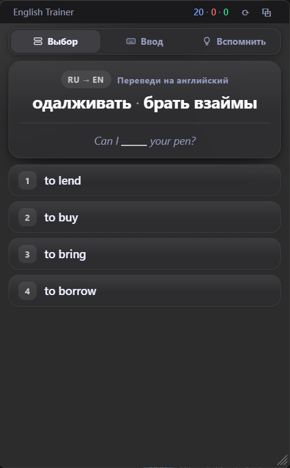

# English Trainer для Anki

Тренажёр английских слов поверх [Anki](https://apps.ankiweb.net): карточки в три режима, плавающий
виджет, который сам зовёт заниматься, и **офлайн-голос**, который звучит как живой человек.
Интервалы повторения считает Anki (FSRS), всё синхронизируется через AnkiWeb — с телефоном тоже.

<p align="center"></p>

## Что умеет

- **Словарь ~1261 слов и растёт** — к цели 2500–3000 слов до уровня C1: самые нужные слова английского
  по частотному списку [NGSL](https://www.newgeneralservicelist.com/), разговорные связки, фразовые глаголы,
  идиомы и рабочий английский (созвоны, переписка). У каждого слова — перевод, живой пример, пояснение
  и три похожих неправильных варианта. Новые слова приходят с обновлениями колоды, прогресс сохраняется.
- **Три режима карточки** — «Выбор» (4 варианта), «Ввод» (напечатать слово) и «Вспомнить»;
  три направления: RU → EN, EN → RU и пропуск в примере.
- **Режим «Авто»** (по умолчанию) усложняет упражнение по мере запоминания: новое или забытое слово —
  выбор из вариантов; интервал от 4 дней — печатаешь английское слово сам; от 21 дня — и русский перевод.
  Ошибка возвращает слово на выбор. Интервалы по-прежнему считает Anki.
- **Сама ставит оценку**: верно — «Хорошо», ошибка — «Снова» и сразу попытка напечатать правильно.
  Опечатку можно засчитать одной кнопкой.
- **Виджет поверх всех окон**: компактное окно в углу экрана. Когда подходят карточки, урок начинается
  сам и не закрывается, пока не пройден. Размер — за любой угол, всё содержимое масштабируется.
  Обычное окно Anki — одной кнопкой ⧉.
- **Офлайн-голос Piper**: слова и примеры произносит нейросетевой голос прямо на компьютере, без
  интернета и задержек.
- **Прогресс по уровням** (A1-A2, B1-B2, B2-C1) на экране колоды.
- **Сложные слова — по нарастающей**: новые слова B2-C1 сначала идут примерно каждым 7-м новым, по мере
  того как база выучена — до каждого 2-го; если они даются тяжело (больше 20% «Снова» за 2 недели), их
  становится вдвое меньше. Меняется только порядок ещё не показанных карточек.
- **Свои слова** добавляются прямо в Anki: достаточно английского и русского — неправильные варианты
  для режима «Выбор» дополнение подберёт само из ваших слов.
- **Телефон**: колода работает в AnkiDroid (Android) и AnkiMobile (iPhone) — карточки те же,
  голос — системный голос телефона. Режим «Авто» работает и в AnkiDroid; на iPhone — ручной выбор режима.

## Установка — три способа на выбор

### 1. Всё сразу — установщик (рекомендуется)

Ставит Anki (если его нет), дополнение, голос и колоду. Нужно один раз, ~5 минут.

1. Скачайте `English-Trainer-Setup.zip` со страницы
   [Releases](../../releases/latest) и распакуйте.
2. **Windows:** двойной клик по `install.cmd`.
   **Linux / macOS:** в терминале в этой папке: `bash install.sh`.
3. Когда Anki откроется — подтвердите импорт колоды.

Другой голос: `install.cmd en_US-ryan-high` (мужской, американский) или
`install.cmd en_GB-cori-high` (женский, британский). То же для `install.sh`.

### 2. Anki уже стоит — дополнение + колода

1. Скачайте `english_widget.ankiaddon` и `English_Trainer.apkg` со страницы [Releases](../../releases/latest).
2. Двойной клик по `english_widget.ankiaddon` → Anki установит дополнение → перезапустите Anki.
3. Двойной клик по `English_Trainer.apkg` → импорт колоды.
4. Голос: в Anki «Инструменты → English Trainer: скачать голос» (один раз, ~135 МБ).

### 3. Только карточки

Скачайте `English_Trainer.apkg` и откройте в Anki (или в AnkiDroid / AnkiMobile на телефоне).
Карточки работают и без дополнения — без виджета и с системным голосом.

## Как пользоваться

- Anki открывается **виджетом**. Крестик прячет его в трей (значок у часов), совсем выйти — правый клик
  по значку → «Выход».
- Меню значка в трее: «Занятие сейчас», «Показать как окно / виджет», «Синхронизировать»,
  **«Запускать вместе с системой»** — включите, и уроки будут приходить сами.
- Уроки приходят, когда Anki решил, что пора повторять, вы за компьютером и ничего не открыто на весь
  экран. Виджет не перехватывает клавиатуру: щёлкните по нему, чтобы отвечать.
- Полоска сверху виджета: перетащить — переместить; ⟳ — синхронизация; ⧉ — обычное окно Anki.

## Свои слова

«Добавить» в Anki → тип записи **English Trainer** → колода **English Trainer**.

| Поле | Что писать | Обязательно |
|---|---|---|
| English | слово или фраза: `to come across`, `reliable` | да |
| Russian | перевод; варианты через `;` | да |
| Example | короткое английское предложение с этим словом | желательно — без него нет карточки «пропуск в примере» |
| WrongEN / WrongRU | 3 похожих неправильных варианта и их переводы, через `;` | нет — подберутся сами |
| Explanation | пояснение, показывается после ответа | нет |
| Hint | подсказка-ассоциация для трудных слов | нет |

Уровень можно отметить тегом: `level::A1-A2`, `level::B1-B2`, `level::B2-C1` — он появится в прогрессе.
Слова с `level::B2-C1` дополнение подмешивает к остальным постепенно (см. «Что умеет»).

## Настройки

«Инструменты → Дополнения → English Trainer → Настройки»: голос, скорость речи, вид по умолчанию.
Подробности — в окне настроек.

## Для разработчиков

```
deck/words.csv        словарь (~1261 слов, пополняется)
deck/src/             шаблоны карточек: HTML/CSS/JS (ES5, работает в AnkiDroid)
deck/build.py         words.csv -> English_Trainer.apkg   (pip install genanki)
deck/tests/           check_deck.py (качество слов), test_core.js (node)
addon/english_widget/ дополнение: виджет (trainer.py), голос (__init__.py), статистика, автоподбор,
                      темп сложных слов (pacing.py)
install.cmd/.ps1/.sh  установщики
tools/make_release.py собирает .ankiaddon и English-Trainer-Setup.zip
tools/import_words.py обновляет deck/words.csv из большого списка того же формата
```

Оценки ставит только сам Anki (штатные кнопки / AnkiDroid JS API) — интервалы дополнение не трогает.
Режим «Авто» читает состояние карточки (`window.ET_CARD` от дополнения или JS API AnkiDroid), пороги — `AUTO`
в `deck/src/ui.js`.

---

## English (short)

An English vocabulary trainer on top of Anki: cards with an auto mode (multiple choice for new words,
typing once a word is remembered), adaptive pacing of advanced words, a floating
always-on-top study widget that starts lessons by itself, and an offline neural voice (Piper).
The UI is in Russian (cards are for Russian speakers learning English).
Install: download `English-Trainer-Setup.zip` from Releases and run `install.cmd` (Windows) or
`bash install.sh` (Linux/macOS) — it installs Anki if needed, the add-on, the voice and the deck.

## Лицензия

Код — MIT, см. [LICENSE](LICENSE). Словарь (`deck/words.csv`, `English_Trainer.apkg`) —
[CC BY-SA 4.0](https://creativecommons.org/licenses/by-sa/4.0/): основа — New General Service List
(Browne, C., Culligan, B., Phillips, J., [newgeneralservicelist.com](https://www.newgeneralservicelist.com/), CC BY-SA).
Голос: [Piper](https://github.com/rhasspy/piper) (MIT),
модели голосов — [piper-voices](https://huggingface.co/rhasspy/piper-voices) (у каждой своя лицензия).
